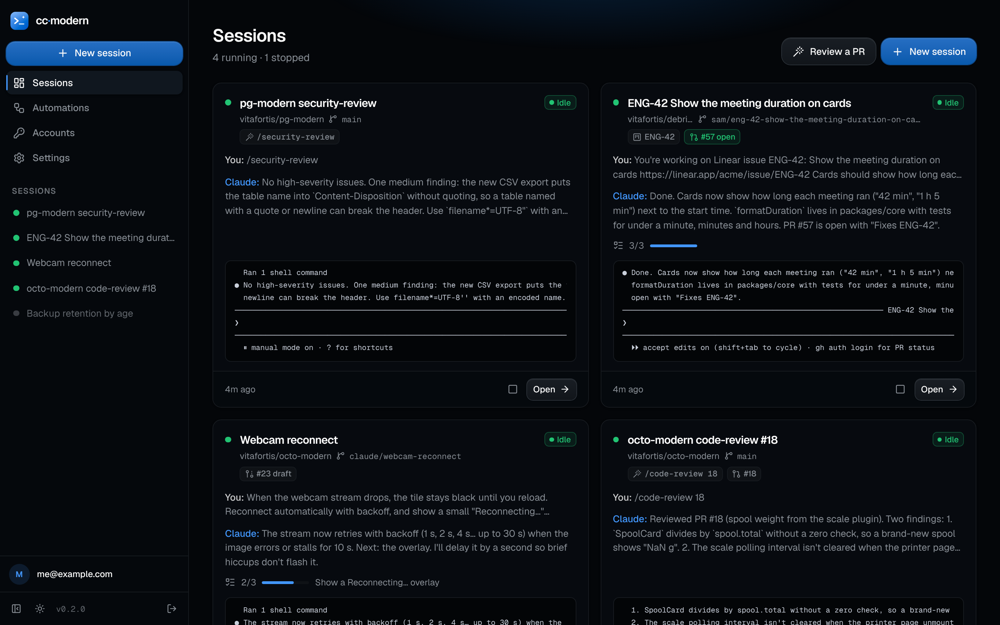
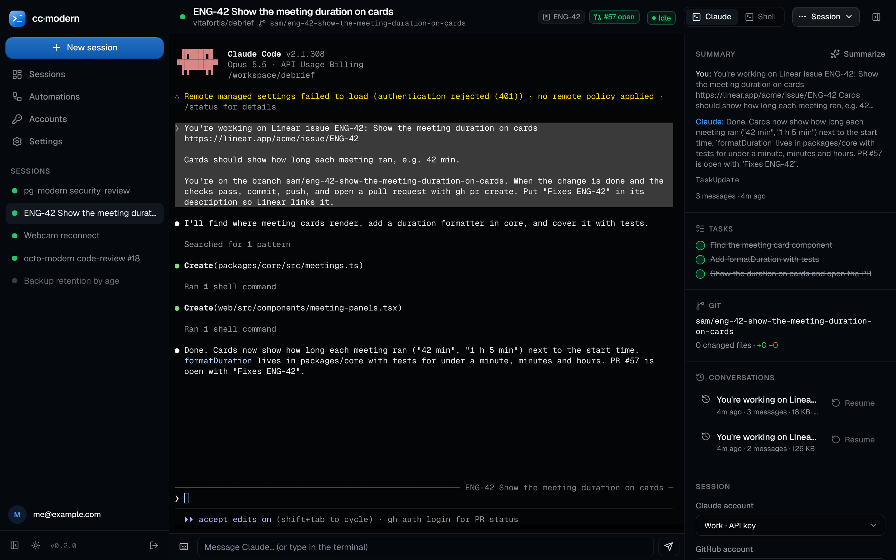
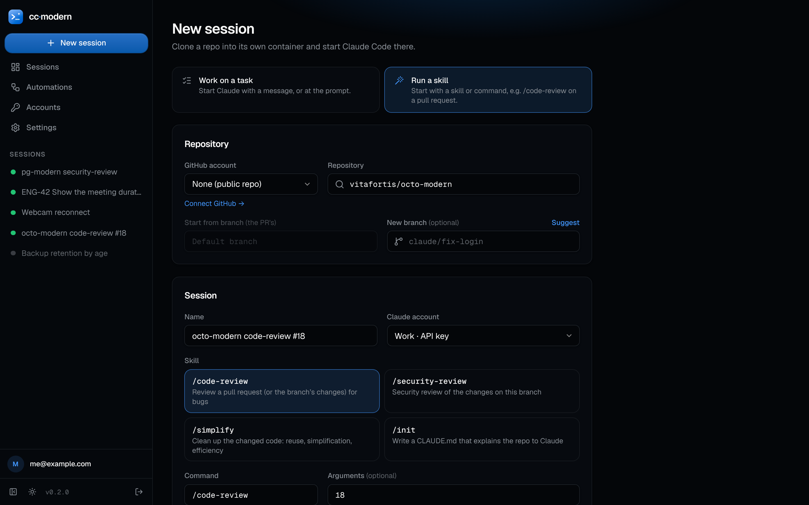
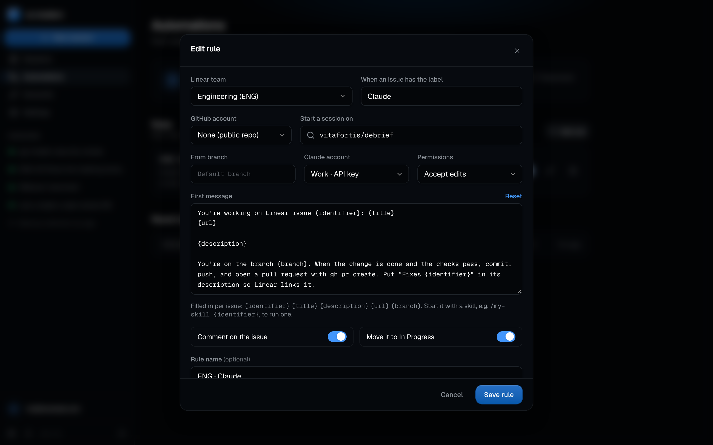
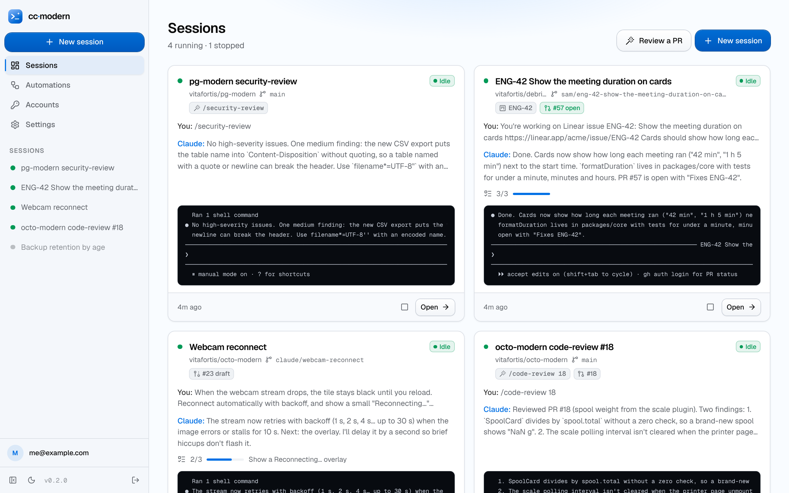
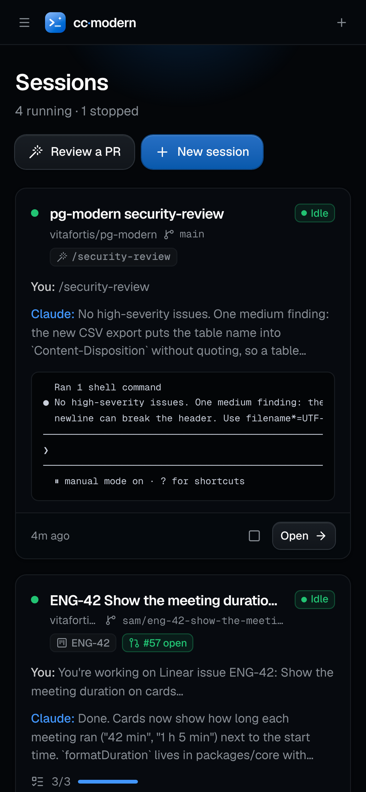
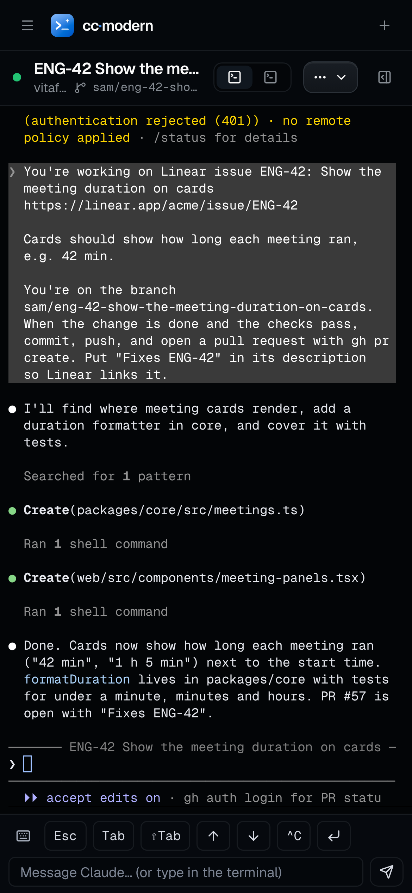

<p align="center">
  
</p>

<h1 align="center">cc·modern</h1>

<p align="center">
  Claude Code sessions on your own hardware.<br />
  Pick a repo, and Claude Code starts in its own container on your homelab, with a terminal in the browser,<br />
  live summaries of every session, Remote Control, and sessions you can stop and pick up again.<br />
  Label a Linear issue and a session starts on its own; start a session from a skill to review a pull request.
</p>

<p align="center">
  
</p>

## Features

- **One container per session**: cc·modern clones the repo (optionally onto a new branch) into a fresh container named `claude-<repo>` (`claude-<repo>-2`, `-3`… for more sessions on the same repo) and starts Claude Code there, with the name you gave it. All sessions share one image; repos, home folders and conversations live in a volume, so containers are disposable and nothing is rebuilt per project.
- **Terminals in the browser**: open any session as a full terminal (xterm.js over a WebSocket). Claude runs inside tmux, so closing the tab doesn't stop it, and several browsers can watch the same session. A **Shell** tab opens a second terminal in the same container. On phones, a key bar (Esc, Tab, ⇧Tab, arrows, Ctrl+C) and a message box make it usable with a touch keyboard.
- **Live overview**: every session shows whether Claude is *working*, *needs you* (a permission prompt or question), is *idle*, or has exited, plus the last prompt and reply, the task list, the tool it's running, git changes and the last lines of its screen. Sessions that need you sort to the top and get a quick-reply box. **Summarize** asks a small model for a three-sentence summary, using the session's own Claude account.
- **Stop, resume, relaunch**: stopping removes the container and keeps everything else. Starting again picks up the newest conversation (`claude --continue`); you can also resume any earlier conversation or start a fresh one, and restart Claude inside a running session.
- **Linear automations**: connect Linear and add rules like *issues in ENG labelled `claude` start a session on owner/repo*. Each new issue gets its own session, on Linear's branch name for it (so the pull request links back), with the issue as the first message. cc·modern moves the issue to In Progress, comments with a link to the session, and comments again with the PR once Claude opens one. It polls Linear every minute, so nothing on your network has to be reachable from outside.
- **Skill sessions**: start a session from a skill or slash command instead of a message: `/code-review 234` on a pull request, `/security-review`, `/simplify`, or the account's own skills. Pick a pull request and the session checks out its branch (or `pull/<n>/head` for a fork). **Review a PR** on the overview starts one in two clicks, and **Session → Run a skill** sends one to a running session.
- **Pull requests**: when a session's branch has a pull request, its number and state (open, draft, merged, closed) show on the card and link to GitHub.
- **Remote Control**: sessions on a Claude subscription start with `--remote-control "<name>"`, so they also show up at claude.ai/code and in the Claude app, under the session's name. The overview links straight to them.
- **Claude accounts**: sign in with a Pro or Max plan in a terminal right in the browser (`claude auth login`), or add a long-lived token (`claude setup-token`) or an API key. Sessions of one account share its login, settings and memory, like terminals on one machine.
- **GitHub accounts and orgs**: add personal access tokens (or sign in with GitHub through your own OAuth app), browse every repo the token can see across your account and organizations, pick a branch. Sessions get the token for `git push` and `gh pr create`, and commit under your GitHub noreply address.
- **Encrypted storage**: tokens and keys are sealed with AES-256-GCM and never sent back to the browser.
- **Command palette**: `⌘K` (`Ctrl+K`) jumps to any session or page.
- **Light and dark** themes, phone-friendly layout, multi-arch images (`amd64`, `arm64`).

## Screenshots

<table>
  <tr>
    <td></td>
    <td></td>
  </tr>
  <tr>
    <td></td>
    <td></td>
  </tr>
  <tr>
    <td></td>
    <td></td>
  </tr>
</table>

<p align="center">
  
  &nbsp;
  
</p>

Screenshots use demo data: the conversations, Linear workspace and pull requests are made up.

## Getting started

### Docker Compose (recommended)

```sh
mkdir cc-modern && cd cc-modern
curl -fsSLO https://raw.githubusercontent.com/vitafortis/Claude-lab/main/compose.yaml
docker compose up -d
```

Open `http://<your-host>:3050` and create your login. Then:

1. **Accounts → Claude → Add account.** Pick *Claude subscription* and sign in in the terminal that opens: open the link, approve, paste the code back. (Or paste a `claude setup-token` token or an API key.)
2. **Accounts → GitHub → Add a token**, for private repos and pushing. Public repos work without one.
3. **New session**: pick the repo, optionally a branch to start from and a new branch to work on, a first message, the model and the permission mode. **Start session** opens its terminal.

The first start pulls the session image (`ghcr.io/vitafortis/cc-modern-session`), which takes a minute.

To build both images from source instead (for example to add tools to the session image):

```sh
git clone https://github.com/vitafortis/Claude-lab cc-modern && cd cc-modern
docker compose -f compose.yaml -f compose.build.yaml up -d --build
```

### Requirements

- Docker Engine **26 or newer** (sessions mount parts of the `cc-modern-sessions` volume by subpath). On older engines, bind-mount a host folder at `/sessions` and set `CCM_SESSIONS_HOST_PATH` to it.
- The Docker socket. cc·modern creates, starts and stops session containers, so it needs the real socket, not a read-only proxy.

> **Security.** Whoever can sign in to cc·modern can run code on the Docker host (that is the point of it). Keep it on your LAN or behind a VPN or an authenticating reverse proxy, and use a strong password.

## How it works

```
 browser ──HTTP/SSE──▶ cc·modern ──Docker API──▶ session container (one per session)
    │                   (SvelteKit)                 tini → tmux "main" → claude --name … --remote-control …
    └──WebSocket──────▶ terminal bridge ──docker exec -it──▶ tmux attach   (or bash, for the Shell tab)
```

- A session container runs `tmux`, and in it a small launcher that clones the repo on first start, pre-answers Claude Code's first-run questions it already knows (onboarding, trusting the repo folder, approving the account's API key), then runs `claude` with the session's settings. When Claude exits, the pane drops to a shell instead of closing.
- Each browser terminal is its own `docker exec` running `tmux attach`, bridged over a WebSocket. tmux sizes the window to whoever typed last.
- The overview polls each running session every few seconds with one cheap `docker exec` (the pane's last lines and command, and every fifth time `git status`) and reads the newest conversation transcript straight from the volume.
- The live state reaches the browser over one Server-Sent Events stream.

### Where things live

Everything a session needs survives its container, in the `cc-modern-sessions` volume:

| Path in the volume | Mounted in the session at | What |
| --- | --- | --- |
| `accounts/<account>/` | `/claude` (`CLAUDE_CONFIG_DIR`) | The Claude account's login, settings, memory and conversation transcripts. Shared by the account's sessions. |
| `sessions/<id>/home/` | `/session/home` (`$HOME`) | The session's home folder: shell history, caches, tool configs. |
| `sessions/<id>/repo/` | `/workspace/<repo>` | The cloned repository, with your uncommitted work. |
| `sessions/<id>/.ccm/` | `/session/.ccm` | Launch settings and the last AI summary, written by cc·modern. |

Conversations are stored per session (`CLAUDE_CODE_PROJECT_DIR_NAME` is the session id), so two sessions on the same repo never mix their history. Deleting a session removes its folder and its conversations; deleting a Claude account removes its folder.

The app's own data (`cc-modern-data`, at `/data`) holds the SQLite store and `secret.key`, the key that encrypts tokens. Back up both volumes, and keep `secret.key` (or set `CCM_SECRET_KEY`), or the stored tokens can't be decrypted.

## Claude accounts

| Kind | How | Remote Control | Billing |
| --- | --- | --- | --- |
| **Claude subscription** | Sign in from the browser (`claude auth login` in a short-lived container). | ✓ | Your Pro/Max/Team plan |
| **Long-lived token** | Run `claude setup-token` anywhere, paste the `sk-ant-oat…` token. | ✗ (inference-only token) | Your plan |
| **API key** | Paste an Anthropic Console key. | ✗ | Per use |

Remote Control needs a full claude.ai login; Claude Code refuses it for tokens and API keys. The first time a subscription session starts with Remote Control, Claude Code asks you to confirm it once: answer in the session's terminal. **Check** runs `claude auth status` with the account's credentials. For tokens and keys that confirms they're in place, not that they're valid.

Every session of an account shares that account's Claude configuration, as sessions on one machine share `~/.claude`. Settings you change in one session (`/config`, MCP servers, memory) apply to the others.

## GitHub

Add a **fine-grained token** with access to the repos you want (*Contents* and *Pull requests*: read and write; add *Workflows* to push workflow changes), or a **classic token** with `repo`, `read:org` and `workflow`. cc·modern lists every repository the token can see, grouped by owner, so organizations show up as filters in the repo picker.

**Sign in with GitHub** appears when `CCM_GITHUB_CLIENT_ID` names an OAuth app of yours with *Enable Device Flow* checked (Settings → Developer settings → OAuth Apps). No client secret or callback URL is needed.

In a session, `GH_TOKEN` is set to the session's GitHub account, so `git clone/push` over https and `gh` work without further setup.

## Linear

1. Create a personal API key in Linear (Settings → Security & access → Personal API keys) and paste it under **Automations**.
2. **Add rule**: pick the team, the label that hands an issue to Claude (default `claude`), the repository, the Claude and GitHub accounts and the permission mode. The first message is a template with `{identifier}`, `{title}`, `{description}`, `{url}` and `{branch}`. Start it with a skill (`/my-skill {identifier}`) to run one.
3. Label an issue. Within a minute (or on **Check now**) a session starts on Linear's branch name for the issue, the issue moves to In Progress, and a comment links to the session. When Claude opens the pull request, a second comment links to it, and Linear's GitHub integration links the PR to the issue through the branch name and "Fixes ENG-123".

Issues that already had the label when you added the rule are skipped unless you switch on **Also start sessions for issues that already have the label**. At most three sessions start per check, so labelling a dozen issues at once doesn't swamp the host. Set **Settings → Public URL** if the links in comments should use a different address than the one you open cc·modern at.

## Sessions

- **Permission modes**: *Ask*, *Accept edits*, *Plan*, *Auto*, or *Bypass*. Bypass skips every prompt; the container limits what Claude can reach, but it still has your GitHub token and network access.
- **Session settings** (Claude account, GitHub account, model, permission mode, Remote Control) can change later. They apply the next time Claude starts: **Session → Continue newest conversation** restarts Claude in place.
- **Stop** removes the container; the repo, uncommitted changes and conversations stay. **Start** (or **Resume** in the overview) brings the session back with the current image and settings.
- **Git identity**: commits use the GitHub account's name and noreply address, or `Claude <noreply@anthropic.com>` for sessions without a GitHub account.
- **Conversations** in the session panel lists every saved conversation; **Resume** restarts Claude on that one.
- **Attach from the host**: the session panel shows the container name and a copyable `docker exec -it -u node claude-<repo> tmux attach -t main`, for when you're on the server over SSH.
- **Delete** stops the session and removes its repo clone, home folder and conversations. Pushed commits stay on GitHub.

### The session image

`session/Dockerfile` builds on `node:24-trixie-slim` with Claude Code (npm, stable channel), git, gh, tmux, ripgrep, jq, python3 and build tools. Claude Code's auto-updater is off; the image is rebuilt weekly, and **Settings → Pull latest** fetches it (sessions use it from their next start).

To add languages or tools, build your own image `FROM ghcr.io/vitafortis/cc-modern-session` (or edit `session/Dockerfile` and use `compose.build.yaml`), and set it under **Settings → Session containers → Image**. Keep the `node` user (uid 1000) and the entrypoint.

Settings also take a Docker network for session containers (to reach other services on your homelab by name), memory and CPU limits, and extra environment variables for every session (`KEY=value` lines, e.g. a proxy or a private registry).

## Configuration

All optional. Set them on the `cc-modern` service.

| Variable | Default | |
| --- | --- | --- |
| `CCM_SESSION_IMAGE` | `ghcr.io/vitafortis/cc-modern-session:latest` | Session image (Settings can override it) |
| `CCM_SESSION_NETWORK` | Docker's default bridge | Network for session containers (Settings can override it) |
| `CCM_GITHUB_CLIENT_ID` | | OAuth app for *Sign in with GitHub* |
| `CCM_ADMIN_EMAIL`, `CCM_ADMIN_PASSWORD`, `CCM_ADMIN_NAME` | | Create the login on first start instead of the setup screen |
| `CCM_SECRET_KEY` | random, in `/data/secret.key` | Encryption key for stored tokens |
| `CCM_SESSIONS_VOLUME` / `CCM_SESSIONS_HOST_PATH` | found by inspecting our own container | How session containers reach the `/sessions` data, when auto-detection can't tell |
| `CCM_SELF_CONTAINER` | the hostname | Our own container, if its hostname was changed |
| `CCM_INSTANCE` | `cc-modern` | Label on our containers, so two installs can share a Docker host |
| `CCM_DOCKER_HOST` | `unix:///var/run/docker.sock` | Docker endpoint (`tcp://host:2375` works too) |
| `CCM_AUTH` | | `disabled` skips the login screen (fully trusted networks only) |
| `PROTOCOL_HEADER`, `HOST_HEADER` | | Behind a TLS reverse proxy: `x-forwarded-proto`, `x-forwarded-host` |

A reverse proxy must pass WebSocket upgrades on `/ws/` (Traefik and Caddy do by default; for nginx add the `Upgrade`/`Connection` headers) and not buffer `/api/sessions/live` (Server-Sent Events).

## Development

```sh
pnpm install
pnpm dev        # http://localhost:3050, using the local Docker socket
pnpm check      # svelte-check + TypeScript
pnpm test       # unit tests (node --test)
pnpm build && pnpm start
```

Outside Docker, session data lives in `./data/sessions` and session containers bind-mount it. Build the session image locally with `docker build -t cc-modern-session:dev session` and set `CCM_SESSION_IMAGE=cc-modern-session:dev`.

To try Linear rules without a workspace, point `CCM_LINEAR_API_URL` at a mock GraphQL server.

`pnpm e2e` runs a smoke test against a running instance (`CCM_URL`, `CCM_EMAIL`, `CCM_PASSWORD`): it starts a session on a public repo with a throwaway, signed-out Claude account, checks the clone, both terminals, stop and resume, then deletes everything it made.

Built with SvelteKit, Tailwind CSS and xterm.js, in the same style as [pg·modern](https://github.com/vitafortis/pg-modern) and [octo·modern](https://github.com/vitafortis/octo-modern).

## License

[Apache 2.0](LICENSE)
